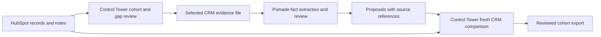

# Pomade and GTM Control Tower CRM cohort implementation plan

Prepare a selected group of existing HubSpot contacts for outbound review using only information already stored in that CRM. Control Tower owns the cohort definition, eligibility and final review. Pomade extracts requested facts from supplied CRM evidence. The deliverable is a saved, downloadable cohort with reasons and evidence for every included, held or excluded contact.

**Original status:** implementation plan, October 13, 2026. The planning change included no runtime implementation. The design below is retained as the original plan, including its planned acceptance checks.

**Implementation update, October 13, 2026:** the CRM-only file loop is now implemented locally in both applications. Control Tower exposes `/app/cohort`, HubSpot metadata/read adapters, saved cohort definitions and evidence requests, returned-result review, and downloadable reports. Pomade imports a saved review table, reuses its context-only helper for selected facts, supports manual outcomes, and exports the correlated result. The existing one-way Pomade handoff is unchanged. Scope ends at review/export; optional conversion into the separate CRM update workflow remains deferred. The full fictional browser roundtrip passed using real local storage and downloads with one intercepted extraction response; 74 focused Control Tower tests, typecheck, focused lint, and the self-hosted build passed. Live HubSpot and actual model qualification have not run. See the [operating guide](crm-cohort-guide.md) and [current handoff](../HANDOFF.md) for usage and qualification boundaries. The original acceptance checks below remain design criteria, not a claim that every planned native check was performed.

## First version

The first playbook is **Prepare closed lost contacts for outreach review**. It uses an operator-selected sales pipeline, lost stages and deal date range to find existing contacts. It requires a configured CRM date field to evaluate 90 days without meaningful contact. It does not reconstruct that date from an entire activity timeline.

| Included | Deferred |
| --- | --- |
| HubSpot contacts associated with selected lost deals; at most 100 selected contacts per request | Salesforce orchestration, new-contact discovery or creation, and unbounded account scans |
| Configurable CRM field definitions, exclusions and simple fit rules | A general playbook builder or arbitrary workflow engine |
| Selected contact, company and deal properties plus explicitly associated CRM notes | Direct inbox/Slack access; standalone email, call and meeting readers; recording or attachment downloads; complete stage-history reconstruction |
| Missing-field proposals supported by the supplied CRM evidence | Web research, enrichment providers, live email verification, guessed email addresses or new company signals |
| Reviewed results and an export of the cohort; optional use of existing CRM update review | Email drafting, sequences, sending, autonomous writes, schedules and win/loss reporting |

Email or meeting summaries already stored in a CRM note or mapped text property can be used. The interface must describe the actual source coverage; it must not claim to have read all conversations. CRM-only describes the **source of information**, not local-only model processing: the optional existing ChatGPT helper receives the selected evidence text.

## Operator workflow

1. In Control Tower's existing self-hosted workspace, choose **Prepare CRM cohort**, select HubSpot and configure the definition below. Preview representative included, excluded and held records before saving it.
2. Read the selected deal population and linked contacts. Deduplicate native contact IDs, apply the fixed rules and show source coverage. Select at most 100 candidates for review; display exclusions rather than deleting records.
3. Select only the missing fields needed for this cohort. Preview the exact records, CRM context and text to include, then download a CRM evidence request. Exporting performs no model calls or CRM writes.
4. In Pomade, import the request into a new review table. Run **Extract from supplied CRM evidence** on a selected batch, or review manually when the helper is unavailable. Rows without requested missing fields need no model run. Existing values stay unchanged and unsupported fields stay empty.
5. Download the correlated result and return it to Control Tower. Control Tower verifies the saved request, rereads relevant CRM values and eligibility fields, and displays supported proposals, conflicts and remaining gaps.
6. Review the final cohort and download the report. Any desired CRM field updates enter the existing explicit update review separately. Preparing or exporting the cohort never creates records, activates a campaign or sends messages.

## Definition saved in Control Tower

Save one reusable definition in the existing workspace metadata, bound to the connected HubSpot portal. Save native IDs/internal property names along with their readable labels. A changed definition creates a new review snapshot; it does not rewrite an earlier request.

| Setting | First implementation |
| --- | --- |
| Deal cohort | Select pipeline and lost-stage IDs from CRM metadata, a close-date property and an explicit date range. Do not infer suitability from the text "Closed Lost." Renamed labels retain identity; deleted IDs require correction. |
| Contact association | Use native deal-to-contact associations. Combine repeated appearances of the same contact while retaining every originating deal. Distinct CRM IDs sharing an email are held as possible duplicates; do not merge them automatically. |
| Inactivity | Select a date/datetime property on the contact and document exactly what updates it. Default threshold is 90 elapsed days at the saved UTC evaluation time, with equality included. Missing, invalid, future or semantically unconfirmed dates are held. Do not substitute record modification, note creation or deal close dates. |
| Loss reason | Map the deal loss-reason property and any relevant text property. Retain source deal IDs. Missing values stay unknown; conflicting notes are shown alongside the field rather than silently changing it. |
| Exclusions | Map CRM properties for do-not-contact, opt-out, disqualification and other customer-defined exclusions. Make null handling explicit; an unmapped or unknown required exclusion is a hold, not permission to contact. Use mapped customer/open-opportunity flags only when their meaning is confirmed. |
| Other deals | Inspect the selected contacts' associated deals for configured active/won exclusions. Include all originating lost deals in context; hold unresolved conflicting outcomes or incomplete association coverage. This does not establish that every other person at the same company is eligible. |
| Fit | A small set of required CRM facts and allowed values/ranges, such as segment, region or company size. Reuse a fixed rule evaluator. Return Meets criteria, Does not meet criteria or Unknown, with the contributing field values. |
| Timing | Evaluate the defined contact date and any mapped next-follow-up date. A future promised follow-up is Not yet. Unsupported or contradictory timing is Unknown. Company news is unavailable unless recorded in the selected CRM evidence. |
| Email status | Map an existing verification result, verified address and verification date, with the user's accepted freshness window. No applicable result means Unverified. Syntax normalization, a sent email or an extracted address never establish verification. |
| Requested facts | Select missing portable fields from job title, company, phone and website. The company field may use an unambiguous associated CRM company. Names, primary email, ownership, lifecycle, consent and native IDs are not extraction/update targets in this version. |
| Evidence | Selected structured properties and associated CRM note text, with object IDs, property names, event dates and retrieval times. Unknown age or ambiguous person attribution requires review. |

Keep three independent assessments: **fit**, **timing** and **evidence support**. Do not turn them into a single unexplained score. Verification remains a separate status. Final row states are **Ready for review**, **Held** and **Excluded**; none means approved to send.

## CRM reads and coverage

Reuse the existing HubSpot authentication, portal identity, property discovery and association handling. Add narrow pipeline metadata and note readers. Pipeline definitions and stage IDs are available from the [HubSpot Pipelines API](https://developers.hubspot.com/docs/api-reference/legacy/crm/pipelines/guide); note properties and associations are documented in the [Notes API](https://developers.hubspot.com/docs/api-reference/legacy/crm/activities/notes/guide). Verify the exact read permissions for those calls during implementation; no new write permission is needed for preparation.

Do not use the current `/api/control-tower/crm-source` sample as an exhaustive cohort. Page through the explicitly selected deal population, then associated contacts and relevant associated deals. Preserve cursors and coverage in the existing saved workspace. Show more available, incomplete or failed reads honestly; a partial scan cannot claim to contain every eligible contact. A selected contact can be reviewed only when the reads needed for that contact's rules are complete.

For the first request, cap selection at 100 contacts and the file at 2 MiB. Include at most 10,000 evidence characters per contact and run model extraction on at most 10 selected contacts at a time, following Pomade's existing bounded-run pattern. If text exceeds the limit, require a visible smaller evidence selection and record omitted source IDs. Do not silently truncate or claim that missing context disproves a fact. Missing association permissions must never fall back to unrelated company-wide notes.

Use contact-linked notes for person facts. A deal note can support a person field only when it identifies that person; otherwise retain it as deal context. A shared company domain is not sufficient attribution. Show notes as recorded statements, not proof of current employment or purchase intent.

## Reuse map

The inspected local baselines are Control Tower `2d6e2d2` and Pomade `5bad3f2`. Paths in the following table belong to the named repository. These are source observations, not claims about a deployed installation.

| Responsibility | Existing implementation to reuse | Small addition |
| --- | --- | --- |
| HubSpot identity and reads | Control Tower `lib/crm-account.ts`, `lib/monitor-hubspot.ts`, `lib/crm-existing-hubspot.ts` | Extract only useful read helpers; add selected pipeline/stage metadata and note reads. Do not run or expand the monitor scheduler. |
| Saved state and UI | Control Tower `lib/workspace.ts`, `lib/workspace-store.ts`, `components/self-host-console.tsx` | Optional definition, cohort, coverage and request metadata; one panel within the existing self-hosted workflow. No second database or service. |
| Cohort rules | Control Tower existing normalization and exclusion conventions | Pure evaluator in proposed `lib/crm-cohort.ts`; separate business eligibility from technical import validity. |
| Pomade table import | `lib/crm-import.ts`, `app/api/tables/route.ts`, `components/pomade-workspace.tsx` | Import the request into a new saved table while retaining portal, contact, deal and evidence identities. |
| Context-only extraction | Pomade `app/api/account-memory/extract/route.ts`, `lib/account-memory.ts`, `scripts/codex-research.mjs` | Reuse forced Codex, browser disabled and `purpose: plan`; add requested-field output parsing. The current account-memory helper validates source quotations. |
| Proposals and source display | Pomade `lib/control-tower-adapter.ts`; Control Tower `lib/pomade-handoff.ts`, `components/pomade-source-context.tsx` | Reuse portable field mappings and evidence display for correlated results, keeping analysis context separate from CRM field proposals. |
| Optional later write | Control Tower `lib/governed-crm-plan.ts`, existing Safe Import/review/verification | Convert accepted proposals through the existing updates-only path; no new writer or automatic approval. |

Pomade's general `/api/runs` path can call enrichment and web research. This workflow must not dispatch through that general path. Reuse the actual context-only execution mode, not merely a prompt saying "do not browse." Do not fall back to another research provider when the helper is unavailable.

## Request and result files

Add a small, separately identified CRM evidence request/result envelope, version 1, using the existing field and evidence conventions. The existing Pomade handoff version 1 remains unchanged and continues to work independently. This extra envelope is needed for request correlation, portal identity and review assessments; it is not a second CRM write format.

| Request field group | Purpose |
| --- | --- |
| Kind, version, request ID, created time | Identify the file and supported reader. |
| Source workspace/revision, definition snapshot and content digest | Correlate a result with the exact saved request. The digest is a consistency check, not a signature or proof of trust. |
| Portal ID and object/native contact IDs | Preserve identity independently of email changes; attach originating deal and company IDs. |
| Existing values and requested missing fields | State exactly what may be proposed. Include field meanings and current CRM values. |
| CRM evidence items | Source object/record ID, property or note identifier, event/retrieval dates, exact value/text, and CRM link when available. |
| Assessments and coverage | Preserve initial fit/timing/exclusion findings, pending questions and missing/omitted sources. |

The result echoes the request identity and contains one outcome for **every requested contact and field**, including unchanged, not run, not found and failed outcomes. Proposed fields return `supported`, `conflicting` or `not_found`, with source IDs, exact excerpts and a short rationale. Keep the original evidence snapshot with the saved request; the result references it rather than duplicating entire notes. Evidence support is separate from extraction execution status.

On import, validate the complete file before changing the active workspace. A result for another portal, unknown request, duplicate/conflicting row identity, unrequested field or unsupported version fails visibly. A subset result must explicitly account for omitted/unprocessed rows rather than dropping them. A repeated unchanged import reopens its existing review instead of duplicating proposals; divergent reruns remain separate revisions of that review.

An exact excerpt match establishes traceability only. Pomade still proposes the interpretation for review. Treat source text as data, reject invented source IDs or excerpts, preserve ambiguity and do not let notes trigger tools or operations.

Before final review, Control Tower rereads the saved native contacts and the fields/associations used by the eligibility rules. Missing or changed targets are held. Values populated since export remain protected; stale eligibility or changed definitions require a refreshed review. A native ID in a returned file is never sufficient write authorization. If a user later opens the existing CRM update flow, its independently resolved target must match the saved request target; hold any mismatch instead of rematching silently by email.

## Implementation sequence

| Increment | Owner and concrete changes | Completion condition |
| --- | --- | --- |
| 1. Definition and shared examples | Control Tower: proposed `lib/crm-cohort.ts` and `lib/crm-evidence-request.ts`. Pomade: a matching small parser in proposed `lib/crm-evidence-request.ts`. Add the same fictional request/result examples to each existing test suite; no shared runtime package. | Identical examples parse on both sides. Rules produce inspectable reasons; unsupported formats and mismatched identities are rejected. |
| 2. HubSpot cohort and evidence | Control Tower: proposed `lib/hubspot-cohort.ts`, `app/api/control-tower/crm-cohort/route.ts`, `components/hubspot-cohort-panel.tsx`; reuse existing persistence and source console. | Operator selects a real CRM definition, previews counts and coverage, saves the selected cohort and exports a bounded evidence request. All CRM operations are reads. |
| 3. Pomade import and extraction | Pomade: extend existing table/import UI; proposed `lib/crm-evidence-extraction.ts` and `app/api/control-tower/evidence/route.ts`; reuse account-memory extraction, current helper settings and receipt display. | A new table survives reload; selected rows produce source-linked proposals from supplied text only. Missing helper offers manual review, never web fallback. |
| 4. Return and review | Pomade: download correlated result using existing download patterns. Control Tower: add a result adapter beside `lib/pomade-handoff.ts`, reuse source context and field review, and extend saved workspace metadata. | Fresh CRM comparison protects newer values. Every requested row is accounted for. Export contains final assessments, reasons, proposed values and source references. Existing handoff and normal imports still work. |
| 5. End-to-end qualification | Both projects: focused existing test runners, one fictional browser roundtrip and a small designated read-only CRM pilot during implementation. | A user can complete the saved-file loop without web enrichment, email verification calls, CRM mutation or sending. Document observed coverage and remaining unknowns. |

Implement sequentially in the suitable existing checkouts; isolation is needed only for concurrent edits. Commit each complete increment. After runtime implementation, record durable decisions in each repository's `docs/decisions.md` and update its existing `HANDOFF.md`. Do not modify the historical September handoff evidence to imply that this new workflow was already qualified.

## Acceptance checks

Use one small fictional cohort with a mix of outcomes, supplemented by boundary cases where needed. These checks are planned, not results of this planning task.

| Scenario | Expected result |
| --- | --- |
| Contact appears under two lost deals | One contact row retains both deal references. Two different contacts sharing an email remain separate and held. |
| Exactly 90 days inactive, 89 days inactive, missing/future dates | Boundary passes; recent contact is excluded; uncertain dates are held. A note edit or record update cannot reset the defined timestamp. |
| Excluded pipeline, test deal, future promised follow-up, active associated opportunity or suppression | Explicit rule/reason; no arbitrary model override. Unreadable required properties or associations are held. |
| Missing title explicitly supported by a contact-specific note | A proposed title retains exact source identity and excerpt. A company-wide note about another person supplies no title. |
| Conflicting or incomplete source evidence | Keep existing values; show conflict or unknown. Never report complete relationship history from the supported subset. |
| Missing or stale email verification | Unverified remains visible; no verification provider is called and no Ready to send claim appears. |
| Notes contain instructions to browse, enrich, contact someone or write to CRM | The context-only model path has no such tools; tests observe zero calls to web/enrichment/verifier/writer/sender paths. |
| Populated field, unsupported output field, fabricated source or changed CRM value | Preserve populated/current values and reject unsupported proposals. Traceability checks do not automatically approve meaning. |
| Wrong portal/request/contact, result reimport, legacy handoff | Reject mismatches; repeated import does not duplicate work; existing handoff behavior is preserved. |
| Oversized selection, remaining pages, failed association read or oversized evidence | Visible limits and incomplete coverage; no silent row/text loss or claim of exhaustive eligibility. |
| Save, reload, export and failed save | Source context and review status survive; failed saves preserve the previous active workspace/table. |

For Pomade, run focused Vitest files covering the new helpers plus `lib/account-memory.test.ts`, `lib/crm-import.test.ts` and `lib/control-tower-adapter.test.ts`; retain the existing context-only client checks in `lib/codex-client.test.ts` and `lib/companion-research.test.ts`. Run `npm run typecheck`, `npm run lint` and `git diff --check`; its runtime release requires both `npm run build` and `npm run build:hosted` under `AGENTS.md`.

For Control Tower, run focused new cohort/request tests plus `tests/pomade-handoff.test.ts`, relevant workspace persistence tests and the existing native-target/update-review tests if that integration path changes. Run typecheck, focused lint and diff checks; build the affected self-hosted app for the browser roundtrip. Reuse the existing Pomade handoff browser script where practical. Do not require public-site, infrastructure or unrelated broad checks for this private workflow unless those lanes change.

The first qualification uses fictional source records and a stubbed model response. It proves the application flow, not model accuracy or live CRM permission coverage. Then use a small designated read-only CRM cohort and review each proposed fact against its actual CRM source. Real customer evidence, model execution and any later writes use the existing authorized account and usage boundaries; they are not actions performed by this planning task.

## Ready to implement

The default scope is settled: HubSpot, selected lost-deal contacts, configured inactivity date, structured CRM properties and linked notes, manual files, context-only extraction and final human review. No implementation depends on adding providers, infrastructure or a sender.

At pilot setup, the operator supplies the actual pipeline/stage IDs, property meanings, exclusions, fit criteria, allowed evidence and verification freshness policy. Check current HubSpot read access and Pomade helper availability then. Missing access or missing authoritative data should produce useful held rows and setup guidance; it must not trigger broader searches or fabricated replacements.
